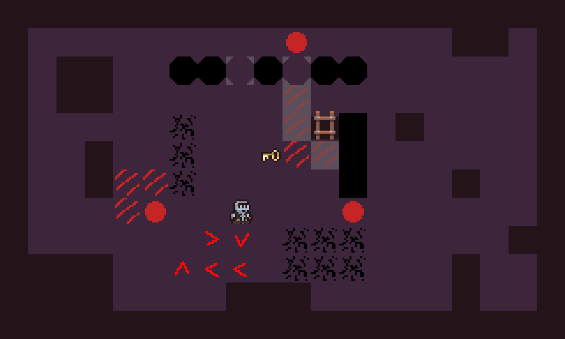
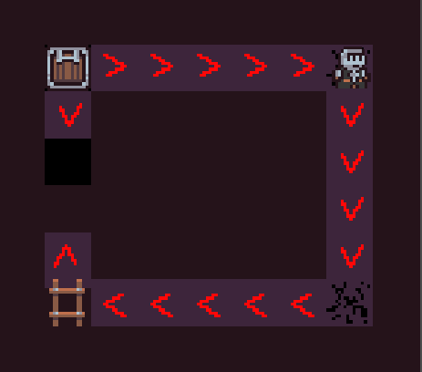
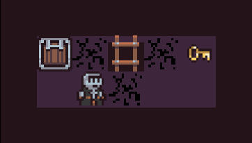

# Dungeon Collapse

A small turn-based puzzle prototype I made with Godot 4.5 for a game jam, the first Beginner Jam of the
Godot Collaborative Game Jam community, in January 2026. You find the key and walk to the ladder, in a
dungeon where the floor doesn't stay put.

It's a learning project, not a finished game: there isn't much in it and it isn't pretty. I used the jam to
learn two things I had never done: building levels with a tilemap and its custom data, and a turn-based game
where nothing happens until the player moves.

**Play it in the browser: https://kozumagames.itch.io/dungeoncollapse**

## The jam

The jam was collaborative and ran in stages. In the first one, every participant built their own prototype
of the jam's idea, a dungeon whose floor collapses, and the prototypes then fed a game made together by the
community ([BeginnerJam1](https://github.com/100-Devs-1-Game/BeginnerJam1)). This repo is my first-stage
prototype, and all the code in it is mine.

## How it plays

Each key press is one turn: you move one cell, then the dungeon reacts. Take the key, then step on the ladder.
If you fall, the level starts over. There are six levels, one for each kind of tile and a last one that
mixes them all, then the game loops back to the first.

| Tile | What it does |
| --- | --- |
| Floor and wall | you walk on one, the other blocks you |
| Cracked floor | turns into a hole as soon as you leave it |
| Hole | you fall |
| Octagons | switch between floor (grey corners) and hole (black) on every turn |
| Red arrows | push you one more cell their way, so a row of them carries you along |
| Red button | swaps the striped tiles: the red ones are floor, the grey ones are holes |

Move with WASD or the arrow keys. WASD are read by position on the keyboard, so on AZERTY it's ZQSD.

## How it works

### The tilemap

Each level is a scene with two `TileMapLayer` nodes. `Floor` holds the tiles you walk on. `Objects` uses a
scene collection, so the key and the ladder are scenes painted like tiles, each with an `Area2D` that
notices the player.

The TileSet has two custom data layers. `tile_def` holds a `TileDefinition` resource, and each kind of tile
is a small subclass of it (`WallTile`, `CrumblingTile`, `VoidTile`, `ConveyorTile`...) that overrides
`on_enter` and `on_exit`. `direction` tells a conveyor where to push. The game never checks which picture a
cell shows: it asks the cell for its definition. To turn a tile into another, `BoardController` calls
`set_cell` with the atlas coordinates of the new one, and the behaviour comes with the picture.

### The turn

The player has a position on the grid, which is the truth, and a position on screen, which follows it with
a tween. One move goes like this (`Player._commit_move`):

1. `TurnManager` switches from `PLAYER_TURN` to `PLAYER_RESOLVING`, and keys are ignored until the move is over.
2. `BoardController.start_of_turn()` switches the octagons.
3. The grid position changes, then the cell you left gets `on_exit` and the new one `on_enter`. Tiles don't
   change the board themselves: they queue a request (collapse this cell, push this actor) or ask the player
   to die.
4. `BoardController.resolve_environment()` runs the queue: cracked cells become holes, conveyor pushes are
   played as new moves, which is how a row of arrows chains.
5. The sprite slides to its cell in 0.2 s. Then it's the player's turn again, or the fall animation plays
   and the level reloads.

The whole turn is settled before anything moves on screen, so the state of the board is always known.

## What's not finished

- On a row of arrows the sprite slides straight to where you end up, instead of following the arrows: the
  whole ride is settled at once and only the last move is animated.
- There are no enemies. `TurnManager` already has `ENVIRONMENT_RESOLVING` and `ENEMY_TURN` states for them,
  but nothing uses them yet.
- `R` (restart) and `Esc` (pause) are mapped in the project settings but do nothing.
- There is no camera: the small levels sit in the top left corner of the window.
- No title screen, no sound, and the end of the last level just goes back to the first.

## Running it

Open `project.godot` with [Godot 4.5](https://godotengine.org/download/) or newer and press F5. The export
presets for the web, Windows and Linux are set up and write to `exports/`.

- `core/`: the turn manager, the board controller and the `GameManager` autoload (current level, key)
- `entities/`: the player
- `tiles/`: the TileSet, `TileDefinition` and one small script per kind of tile, the ladder scene
- `pickups/`: the key
- `levels/`: the six levels

## Credits

The character, the key, the ladder and the dungeon tileset come from the
[2D Pixel Dungeon Asset Pack](https://pixel-poem.itch.io/dungeon-assetpuck) by Pixel_Poem (free version).
I added the simple tiles for the mechanics (arrows, cracks, holes, buttons) to the right of its tileset.
Only the files the game uses are in this repo. The pack's license allows its use in free and commercial
projects, but not its redistribution on its own: download it from its page if you want the rest.

The code is under the MIT license. It doesn't cover the art.
